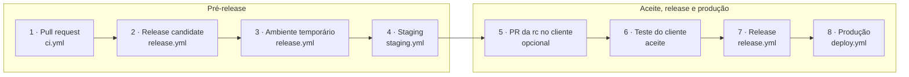

Trunk-based, com controle por tag. Toda mudança entra por [pull request](/how-we-work/pull-requests) na `main`, a única branch de longa duração. Uma tag lança a versão: primeiro a release candidate (rc), depois o release, da mesma rc.

**A tag lança a versão. O merge no repositório do ambiente implanta.** As duas decisões passam por revisão de código, nunca pelo console da nuvem.

## O caminho de uma mudança



A rc passa por dois ambientes antes de chegar ao cliente. O temporário recebe a bateria de testes (carga, segurança e corretude) e é destruído. A staging da Barte recebe toda rc aprovada. O passo 5 é opcional: leva a rc ao ambiente do cliente. O release sai com o OK do cliente.

## Dois ambientes, duas contas

Staging e production ficam em contas de nuvem separadas, sem rede nem papel de acesso entre elas.

O cliente testa a rc em staging. Toda rc vai para a staging da Barte. Quando o cliente tem staging na própria infraestrutura, um PR leva a rc para o ambiente dele, e ele testa lá.

| Ambiente | Onde | Recebe |
|---|---|---|
| temporário | A conta de staging da Barte. Uma rede criada para a rc, com dado sintético, e destruída ao fim dos testes. | Cada rc. |
| staging | A conta de staging da Barte. Uma rede isolada por cliente, sem ligação entre elas. A arquitetura de production, menor, com dado sintético. | Cada rc aprovada no ambiente temporário. |
| production | A conta criada para o cliente, na organização de nuvem dele ou na da Barte, conforme o contrato. | Só o merge de um PR no `versions.tf` ou no `infra/`. |

A esteira roda no GitHub e acessa as contas por OIDC (login temporário, sem chave guardada), em sessões de até uma hora. Uma tag só consegue ler, e só a `main` do repositório do cliente implanta.

## O que cada etapa faz

| Etapa | No módulo | No repositório do cliente |
|---|---|---|
| Pull request | Unidade e análise estática. | O mesmo, mais o `terraform test`, sem acesso à nuvem. |
| Merge na `main` | Publica no GHCR (o registro de imagens do GitHub) uma imagem imutável por app, marcada pelo commit. | Constrói e publica as imagens do projeto, marcadas pelo commit. |
| Release candidate | `vX.Y.Z-rc.N`. As imagens do commit recebem a tag `X.Y.Z-rc.N`. | `<projeto>/vX.Y.Z-rc.N`. Marca as imagens e gera o plan de production (a prévia do Terraform), com papel só de leitura. |
| Ambiente temporário | — | Provisiona um ambiente do zero, aplica a bateria de testes e destrói o ambiente. |
| Staging | — | Implanta a rc na staging da Barte. Roda o e2e e o pentest de primeiro nível. |
| PR da rc no cliente | — | Opcional. Um PR leva a rc para o ambiente do cliente, quando ele tem staging próprio. |
| Teste do cliente | — | O cliente testa a rc em staging, na Barte ou no dele, e aprova o deploy. |
| Release | `vX.Y.Z`. Promove a rc do mesmo commit para `X.Y.Z` e `latest`, sem build novo. | `<projeto>/vX.Y.Z`. Sai com o OK do cliente. Promove as imagens da rc para `X.Y.Z`. Não implanta. |
| Produção | — | Um PR muda a versão no `versions.tf`, e o CI mostra o plan. O merge faz o apply em production e roda o smoke (um teste rápido de funcionamento). |

## Os testes

São seis camadas. Unidade, contrato e integração rodam no CI. A bateria da rc roda num ambiente temporário. E2E e pentest rodam contra staging. **Uma rc só vira release depois de passar pelas seis.**

| Camada | Prova | Onde roda | Bloqueia |
|---|---|---|---|
| Unidade | Cada app, worker e pacote, isolado: sem rede, banco nem relógio real. | CI, no PR. | O merge |
| Contrato | Nenhuma interface muda sem aviso: a que o repositório expõe e a do provedor. | CI, no PR. E agendado contra o sandbox do provedor, que muda sem PR. | O merge |
| Integração | As peças juntas, com banco, fila, motor de workflow, cofre e nuvem emulada. | CI, pelo compose. No cliente, também em staging. | O merge |
| Bateria da rc | Carga, segurança e corretude da solução, num ambiente provisionado do zero. | Ambiente temporário, a cada rc. | A ida a staging |
| E2E | O fluxo do cliente de ponta a ponta, com dado sintético. | Staging, a cada rc. | O release |
| Pentest | Ataques automáticos de primeiro nível: isolamento do dado por cliente e por pessoa, aprovação do irreversível, limite de cada papel, rede sem entrada. | Staging, a cada rc. | O release |

Os tipos de teste que o `ci` cobra de cada camada de código estão na [agência do Ahrena](/how-we-work/agency#o-quality-gate-dentro-do-ci).

### O contrato nos conectores

O teste de contrato detecta quando um provedor muda a resposta sem avisar. Ele compara a resposta com a baseline, a lista de campos gravada.

| Evento | Quer dizer | O que acontece |
|---|---|---|
| `contract.field_appeared` | Um campo novo, sem classificação. | Aviso. Abre uma issue para classificá-lo. |
| `contract.field_vanished` | Um campo parou de vir. | Erro. Bloqueia o merge até o conector ou a baseline mudar. |

### Onde cada teste mora

```text
<módulo>/ ou projects/<projeto>/
├─ apps/<nome>/test/        unidade
├─ workers/<nome>/test/     unidade
├─ packages/<nome>/test/    unidade
└─ tests/
   ├─ contract/      a interface exposta, e a baseline de cada provedor
   ├─ integration/   as peças juntas, pelo compose
   ├─ load/          a carga, na bateria da rc
   ├─ e2e/           o fluxo inteiro, contra staging
   └─ pentest/       os ataques de primeiro nível, contra staging
```

## As regras

| Regra | O que diz |
|---|---|
| A rc sai da `main` | A esteira recusa a tag se o commit não está na `main`. |
| O release sai da rc | Exige uma rc no mesmo commit e promove o mesmo artefato, byte a byte. |
| O release fecha no aceite | A tag de release sai depois do OK do cliente em staging. |
| Lançar e implantar são separados | A tag de release só publica. Production muda no merge de um PR no ambiente. |
| O rollback vem antes do PR | Voltar a uma imagem que já esteve no ar é a única mudança em production antes do PR. O PR depois alinha o `versions.tf`. |
| Uma tag por projeto | No cliente, `<projeto>/vX.Y.Z`, uma versão por projeto. No módulo, `vX.Y.Z`. |
| Uma versão por módulo | Os apps de um módulo saem do mesmo commit, com a mesma versão. |
| A versão é a tag | Sem branch de release, sem commit de bump, sem versão no manifesto. |
| A rc é leve | Tag leve, sem mensagem. Pode mudar de commit na `main` até a versão sair. Movê-la reconstrói o pre-release. |
| O release é anotado | Tag anotada (autor, data, mensagem) e protegida. Só os responsáveis pelo release a criam. Ninguém a move ou apaga. |
| Entrada por OIDC | Sem chave guardada. Na conta do cliente, o papel confere a origem do acesso. |

## Os workflows

Cada etapa da entrega é um workflow, com o mesmo nome de arquivo em todo repositório, em `.github/workflows/`.

| Arquivo | Dispara em | No módulo | No cliente |
|---|---|---|---|
| `ci.yml` | Pull request e push na `main` | Unidade, lint, tipos e análise estática. | O mesmo, mais o `terraform test`. |
| `publish.yml` | Merge na `main` | Publica no GHCR uma imagem por app e por worker. | O mesmo, por projeto. |
| `staging.yml` | rc aprovada no ambiente temporário | — | Implanta a rc em staging e roda e2e e pentest. |
| `release.yml` | Tag de rc e tag de release | Na rc, marca as imagens com `X.Y.Z-rc.N`. No release, promove-as para `X.Y.Z` e `latest`. | O mesmo, por projeto. Na rc, publica também o plan de production, sobe o ambiente temporário, aplica a bateria de testes e destrói o ambiente. |
| `deploy.yml` | Merge na `main` que muda `versions.tf` ou `infra/`, e disparo à mão na `main` para o rollback | — | Apply em production e smoke. No rollback, volta os serviços à imagem anterior, sem esperar PR. |
| `docs.yml` | Merge na `main` | Constrói e publica a documentação. | O mesmo. |

O `contract.yml`, agendado, fica fora da entrega: nunca publica nem implanta. **Só o `deploy.yml` implanta em production.**

O workflow `ci.yml` é o check `ci` que o ruleset exige. Ele roda em todo PR, sem filtro de caminho, e chama os workflows reutilizáveis da organização ([pull requests](/how-we-work/pull-requests)).

## Versões

A versão segue o [Semantic Versioning](https://semver.org/): `vMAJOR.MINOR.PATCH`. A rc acrescenta o sufixo `-rc.N`.

| Parte | Sobe quando | Exemplo |
|---|---|---|
| MAJOR | A mudança quebra o que existia ou exige ação de quem consome. | `v1.4.2` → `v2.0.0` |
| MINOR | Funcionalidade nova, sem quebra. | `v1.4.2` → `v1.5.0` |
| PATCH | Correção, sem funcionalidade nova. | `v1.4.2` → `v1.4.3` |
| rc.N | Versão candidata. Se a `rc.1` falha, a correção sai na `rc.2`. | `v1.5.0-rc.1` → `v1.5.0` |

```bash
# a rc: leve, e pode ser movida enquanto a versão não sai
git tag my-project/v1.5.0-rc.1 origin/main
git push origin my-project/v1.5.0-rc.1

# o release: anotado, no commit da rc
git tag -a my-project/v1.5.0 -m "my-project v1.5.0" my-project/v1.5.0-rc.1
git push origin my-project/v1.5.0
```

Enquanto o MAJOR for 0, um MINOR pode quebrar compatibilidade. A `v1.0.0` marca a primeira versão estável em produção.

## Da versão à instalação

O ambiente do cliente decide quando uma versão sobe. O `versions.tf` fixa a versão de cada módulo e de cada projeto, e um PR a muda. O rollback troca só a imagem em execução, antes do PR.

<Steps>
<Step>

### Sozinho

Se as tarefas novas não sobem saudáveis, a trava automática de implantação do orquestrador de contêineres mantém a versão anterior.

</Step>
<Step>

### À mão

Se a versão nova falha em uso, alguém do release dispara o `deploy.yml` na `main` com a versão anterior. Sem build nem revisão, em minutos.

</Step>
<Step>

### O PR de correção

O plan passa a mostrar divergência com o `versions.tf`. Um PR reverte o arquivo ou traz a correção numa rc nova, como PATCH.

</Step>
</Steps>

<Callout>
O motor de workflow guarda o estado dos processos fora do worker. Quando a imagem anterior volta, eles continuam de onde pararam.
</Callout>

Como uma versão do upstream chega a cada cliente está em [do cliente à plataforma](/how-we-work/development-cycle#o-que-vai-para-o-cliente).
