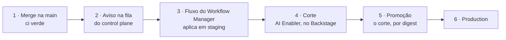

Trunk-based. Toda mudança entra por [pull request](/how-we-work/pull-requests) na `main`, a única branch de longa duração. **Staging é do time, e production é um corte.** Quem orquestra a entrega é o Workflow Manager do control plane, e cada passo se vê no Backstage.

## O caminho de uma mudança

| Passo | O que acontece |
|---|---|
| 1 · Merge | O PR entra na `main` com o `ci` verde. |
| 2 · Aviso | A pipeline do repositório da organização põe um aviso numa fila do control plane. Ninguém chama o Backstage de fora: a fila aceita só as roles dessas pipelines. |
| 3 · Staging | Um worker do Backstage lê a fila e inicia o fluxo de deploy no Workflow Manager, que aplica a versão em staging. Cada commit da `main` que passa no `ci` é uma versão de staging, aplicada sozinha, sem aprovação. |
| 4 · Corte | O AI Enabler, o tech lead do projeto, clica em «Cortar versão» no Backstage. O corte só aceita um commit aplicado e saudável em staging, e mostra o que entra desde o corte anterior. O app do GitHub cria a tag. |
| 5 · Promoção | Outro clique, de quem opera. A promoção só aceita cortes, e aplica o commit e os artefatos da tag pelo digest, sem build novo. |
| 6 · Production | A aplicação sobe sobre a base de production, que já está pronta desde a verificação da conta ([da organização ao projeto](/how-we-work/development-cycle)). |

Cortar e promover são cliques separados, de pessoas diferentes: quem corta é o AI Enabler, e quem promove é quem opera.

## O corte

| Regra | O que diz |
|---|---|
| A forma | `<project-slug>/v<ano>.<semana>.<n>`, como `contas-a-pagar/v2026.44.0`, e `contas-a-pagar/v2026.44.1` para uma correção na mesma semana. |
| Por projeto | As versões de um projeto são os commits da `main` que mexem nele. Cada projeto tem os seus cortes e a sua promoção, e em production cada projeto roda no seu corte. |
| O ritmo | De preferência semanal: toda sexta, um lembrete no canal interno da organização. Um corte fora da semana continua possível, para uma correção urgente. |
| Quem cria a tag | Só o app do GitHub, com um token de uma hora. Um ruleset protege as tags `*/v*`, e nenhuma pessoa as cria. |
| O rollback | Voltar uma versão é promover um corte anterior. Voltar um projeto não mexe nos outros. |

## O ambiente e o projeto

Os fluxos cuidam de duas coisas, em ritmos diferentes.

- **O ambiente** se prepara uma vez em staging e uma vez em production: a conta, a rede, a base, o core operacional e os conectores. Criar a organização prepara staging, e a conta de production verificada prepara production.
- **O projeto** muda o tempo todo: os fluxos, as views, os apps e os agents. Aplicar uma versão de projeto não sobe nem muda o ambiente.

| Ambiente | Onde | Recebe |
|---|---|---|
| staging | A conta compartilhada de staging da Barte. | Cada commit da `main` que passa no `ci`, de forma contínua. |
| production | Uma conta da organização, sempre dentro da org AWS da Barte. | Só a promoção de um corte. |

O apply de production de uma instalação mantém a aprovação no environment `production` do GitHub. Staging é contínuo. Os deploys do próprio Backstage também são contínuos.

## Os módulos

Os módulos da plataforma têm uma versão por módulo, e os apps de um módulo saem do mesmo commit.

| Regra | O que diz |
|---|---|
| A tag | `vX.Y.Z-rc.<train>.<n>`, e o release `vX.Y.Z` sai da rc, com o mesmo artefato. |
| Quem cria a tag | Só a esteira ou o app. Ninguém roda `git tag` à mão. |
| A imagem | Cada app e worker vira uma imagem imutável, com atestação de origem. |
| A instalação fixa | O `versions.tf` do repositório da organização fixa a versão de cada módulo, e mudar a versão é um PR nele. |

## Os testes

| Onde | O que roda | Bloqueia |
|---|---|---|
| O `ci`, no PR | Os tipos de teste de cada camada, a rastreabilidade, as convenções, o bloco do handbook e o gitleaks | O merge |
| Staging | A versão aplicada precisa estar saudável | O corte |

Os testes que atravessam um projeto ficam em `projects/<project-slug>/tests/`, em `contract/`, `integration/`, `e2e/`, `pentest/` e `stress/`, só com dado sintético em `fixtures/`.

## O que ainda roda no GitHub

O GitHub guarda o código, o template, o `ci` das PRs e as releases com as atestações. Os workflows `staging` e `deploy` do template e o `apply` das roots de instalação saem à medida que cada fluxo passa a rodar no Workflow Manager. Até lá, os dois coexistem, e um merge pode disparar os dois. Nenhum workflow novo de deploy entra no GitHub Actions.

Fonte: ADR-004 D2, D3 e D6, ADR-005 D5 e ADR-007 D3 e D4 do backstage, seção B.10 e decisão 5 da barte-ai-services/.github#24.
