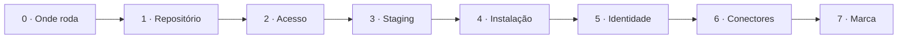
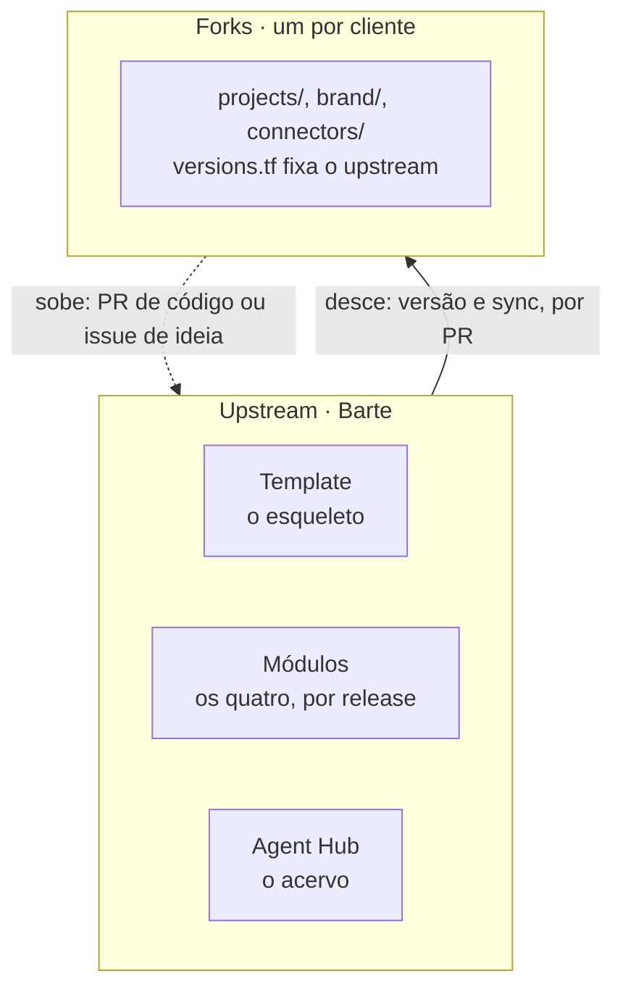
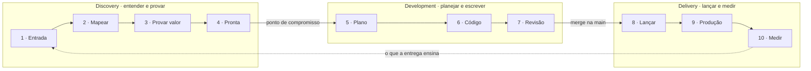
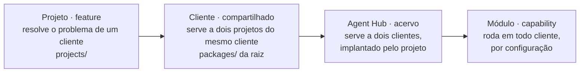
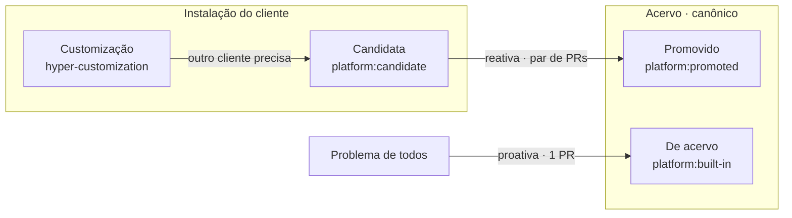
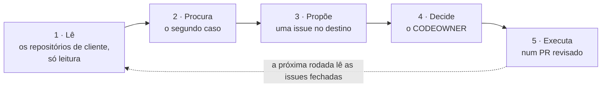

Um cliente entra, um projeto começa, e parte do código passa para a plataforma. **Todo código nasce no projeto de um cliente e só sobe quando serve a mais de um.**

A Barte mantém o upstream, o repositório original. Cada cliente tem um fork, uma cópia que recebe as atualizações. Os termos estão no [glossário](#glossário).

## Um cliente novo

Cada cliente novo recebe uma instalação e um repositório, criados do esqueleto padrão. Ninguém escreve código novo nesta etapa.

| Passo | O que acontece | Onde fica |
|---|---|---|
| 0 · Onde roda | Na infraestrutura do cliente ou da Barte. A conta é sempre nova e só dele. | O contrato |
| 1 · Repositório | O Barte Forge cria o repositório do cliente, o fork. Ele vem com o remote `upstream`, e com `.github/` com `CODEOWNERS` (quem é dono de cada pasta), modelos de issue, `LICENSE` e `NOTICE`. | O Forge e o GitHub |
| 2 · Acesso | Provedor OIDC do GitHub (login sem senha guardada), papéis de plan e de apply, limite de permissões e o armazenamento do estado. Aplica quem é dono da organização na nuvem: o cliente ou a Barte. Nenhuma chave muda de mão. | A conta dedicada |
| 3 · Staging | Uma rede isolada com a arquitetura de produção, só com dado sintético e sem ligação com outros clientes. | A conta de staging da Barte |
| 4 · Instalação | Sobem a conta, a rede e os quatro módulos (Integration Gateway, Data Operator, Workflow Manager e Identity Manager), nas versões fixadas. É o primeiro merge que o `deploy.yml` implanta. | `versions.tf`, `infra/` |
| 5 · Identidade | No primeiro deploy, o Identity Manager cria a organização e a pessoa dona. Depois, só confere. | O environment do GitHub |
| 6 · Conectores | O Integration Gateway habilita os conectores. O cliente, ou quem ele autorizar, guarda cada credencial. | `connectors/` e o cofre |
| 7 · Marca | A marca do cliente nas telas. | `brand/` |

**Pronto quando** os quatro módulos respondem, a pessoa dona entra pelo Identity Manager e ainda não existe projeto.

## Um projeto novo

Um projeto resolve um problema do cliente e tem data de entrega. O código só começa depois que o processo do cliente está escrito.

| Passo | O que acontece | Onde fica |
|---|---|---|
| 1 · Initiative | O problema, os limites do escopo e as decisões. | Uma [issue](/how-we-work/issues) do tipo Initiative |
| 2 · Contexto | O processo atual, as transcrições das sessões, o objetivo e os critérios de aceite. | `projects/<projeto>/docs/context/` |
| 3 · Plano | Épicos com milestone, tasks com aceite testável e uma sub-issue plan por task, com o prompt de execução. | Issues e milestones |
| 4 · O que já existe | O que o Agent Hub e os módulos já resolvem entra pela versão, sem cópia. | `versions.tf`, `agents/`, `flows/` |
| 5 · Código | A feature nasce em `apps/`, `workers/` e `packages/` do projeto e usa os pacotes da raiz do cliente. | `projects/<projeto>/` |
| 6 · Primeira versão | A rc `<projeto>/v0.1.0-rc.1` passa por staging e vira release. Um PR no `versions.tf` a leva à produção. | [Do commit à produção](/how-we-work/delivery) |
| 7 · Entregas | O que foi feito, o que mudou e o que falta. | `docs/context/` |

## Upstream e fork

A Barte é o upstream, e cada cliente é um fork. O upstream guarda o template, os quatro módulos e o Agent Hub. O fork, o `origin` do cliente, guarda os projetos dele.

O fork nasce do template, com o remote `upstream` apontando para o template da plataforma, sem o botão Fork do GitHub.

Toda descida passa por um PR. Na linha tracejada sobe código ou ideia, **nunca dado do cliente**.

| Direção | O que passa | Como |
|---|---|---|
| Desce · versão | Módulos e Agent Hub. | PR do Forge no `versions.tf`. O fork adota quando quiser. |
| Desce · esqueleto | `.github/`, workflows e modelos de issue. | PR de sincronização do Forge a cada release do template. O maintainer do fork revisa. |
| Sobe · código | Uma melhoria que serve a outros clientes. | PR de contribuição, com uma issue de contribuição. |
| Sobe · ideia | Uma sugestão, sem código. | Uma issue de sugestão, que passa por triagem. |

### As regras do fork

| Regra | O que diz |
|---|---|
| Não editar o upstream no fork | O que vem do template ou do `versions.tf` muda no upstream e desce. O sync desfaz commit direto no fork. |
| O que é do cliente fica | `projects/`, o `packages/` da raiz, `brand/` e a configuração dos conectores nunca sobem como estão. |
| Carry | Uma mudança que o fork precisa antes de o upstream lançar. Leva o label `carry` e uma issue no upstream. Sai quando a versão chega. |

## O ciclo de uma issue

Toda issue passa por três camadas: **discovery**, **development** e **delivery**. O time de um cliente são os fdes, os engenheiros que o atendem, e o client partner.

As camadas são do produto; upstream e fork são do repositório. As camadas acontecem no fork, para o projeto do cliente, e no upstream, para o roadmap.

Duas passagens separam as camadas: o ponto de compromisso e o merge na `main`.

| Etapa | O que acontece | Quem | Sai com |
|---|---|---|---|
| **Discovery** | | | |
| 1 · Entrada | A demanda vira [issue](/how-we-work/issues), sem compromisso. Vem do cliente, do client partner, de um agente ou do roadmap. | Qualquer um | O problema, em uma frase. |
| 2 · Mapear | O processo atual, as transcrições, quem faz o quê e onde estão os problemas. | Client partner, com o cliente | `docs/context/` preenchido. |
| 3 · Provar valor | Uma demo, um piloto ou uma rotina assistida resolve parte do problema, antes de o sistema ser escrito. | Client partner, com um fde | A métrica, e a evidência de que ela se move. |
| 4 · Pronta | Critérios de aceite e métrica. É o ponto de compromisso: o maintainer aceita ou devolve. | Client partner e maintainer | O label `ready`. |
| **Development** | | | |
| 5 · Plano | Épicos com milestone, tasks com aceite testável e uma sub-issue plan por task. | Time | As issues do plano. |
| 6 · Código | Branch e PR no `projects/` do fork ou no repositório do módulo. | Time | O PR aberto. |
| 7 · Revisão | O PR passa pelo `ci` e pela [review automática](/how-we-work/review). | Time | O merge na `main`. |
| **Delivery** | | | |
| 8 · Lançar | A rc passa por staging e vira release anotado. | Time | A versão. |
| 9 · Produção | PR no `versions.tf`. O client partner avisa o cliente do que muda. | Time | A versão em produção. |
| 10 · Medir | A métrica de produção contra a do passo 3. O aprendizado volta ao discovery. | Client partner | A issue fechada e as próximas abertas. |

### O quadro

| Camada | Colunas | Regra |
|---|---|---|
| Discovery | Entrada, Mapeando, Provando, Pronta | Sem limite de entrada. O descarte registra o motivo. |
| Development | Planejada, Em desenvolvimento, Em revisão | Com limite de trabalho em curso. Só puxa da coluna Pronta. |
| Delivery | Em staging, Lançada, Em produção, Medida | Sem código novo, só CI/CD. O que quebra volta a Em desenvolvimento como bug. |

A camada é um campo do Project da organização, igual no fork e no upstream. O projeto novo é a primeira volta do ciclo.

## O que vem do cliente

O cliente contribui com **código**, uma melhoria do fork que serve a outros, ou com uma **ideia**, algo que falta. Os dois abrem uma issue no upstream, e o dono do destino decide, como na [promoção](#promover-para-a-plataforma). O código passa por revisão, e a ideia, por triagem. Os dois terminam numa versão.

<Tabs items={['Código: a contribuição', 'Ideia: a sugestão']}>
<Tab value="Código: a contribuição">

| Passo | O que acontece |
|---|---|
| 1 · Feature no fork | Nasce em `projects/`. Só sobe código já usado num cliente. |
| 2 · A issue no upstream | Uma issue de contribuição no destino: a origem, o que resolve e por que serve a mais de um cliente. |
| 3 · Generalizar | Sai o que é do cliente, e o que varia vira configuração. São os passos 3 e 4 da promoção. |
| 4 · PR de contribuição | Do fork para o upstream, revisado como qualquer PR. O dono do destino decide. |
| 5 · Na versão | Num PR no `versions.tf`, o fork adota a versão e apaga a cópia. |

O que o dono do destino responde:

| Resposta | O que acontece |
|---|---|
| Aceita | Merge no upstream. Sai na próxima release. |
| Pede ajuste | O PR volta com o que falta para servir a outros clientes. |
| Fica no fork | Só um cliente usa. A issue fica aberta até o segundo caso, e o agente de promoção acompanha. |
| Recusa | O motivo fica na issue. O fork mantém a feature. |

A contribuição é uma promoção iniciada pelo cliente.

</Tab>
<Tab value="Ideia: a sugestão">

| Passo | O que acontece |
|---|---|
| 1 · A ideia | O cliente pede, ou o client partner nota a falta no discovery. |
| 2 · A issue no upstream | Uma issue de sugestão no destino: o caso, como é feito hoje e quem pede. Sem dado do cliente. |
| 3 · Triagem | Semanal, pelo maintainer do destino. |
| 4 · Roadmap | A sugestão aceita ganha milestone e entra no ciclo da issue. O dono do módulo faz o papel do client partner. |
| 5 · Na versão | Cada fork adota quando quiser. |

Os destinos da triagem:

| Destino | O que acontece |
|---|---|
| Roadmap | Serve a mais de um cliente. Ganha milestone. |
| Espera | Só um cliente pediu. Fica aberta com o label `second-case` até o +1 de outro. |
| Volta ao fork | Só serve àquele cliente. Fecha no upstream e volta ao fork como initiative. |
| Recusada | O motivo fica registrado. O agente de promoção não a propõe de novo. |

O roadmap é o discovery da plataforma. O cliente acompanha o pedido pela issue do fork, ligada à do upstream.

</Tab>
</Tabs>

## O que vai para o cliente

Toda mudança do upstream chega ao `origin` de cada cliente por PR. O maintainer do fork aceita depois do teste em staging. **Um lançamento no upstream não altera a produção de nenhum cliente.**

<Steps>
<Step>

### Release

Fluxo normal de rc e release, pelo maintainer do upstream. As notas dizem o que mudou, o que quebra e as issues de origem.

</Step>
<Step>

### Quem está atrás

O Forge lê o `versions.tf` de cada fork e mostra quantas versões cada um está atrás.

</Step>
<Step>

### PR no fork

O Forge abre o PR no `versions.tf`, ou o de sincronização do esqueleto. Ele leva as notas e, se quebra algo, o guia de migração.

</Step>
<Step>

### Staging

A versão roda os testes do projeto no staging do cliente, pelo CI do fork. Se quebra, o PR para e vira uma issue de bug no upstream.

</Step>
<Step>

### Aprovação

O maintainer do fork aprova. O client partner avisa o cliente antes, se ele vai notar a mudança.

</Step>
<Step>

### Produção

O `deploy.yml` implanta. O mesmo PR fecha a issue do fork e apaga a cópia ou o carry.

</Step>
</Steps>

O que desce, e com que urgência:

| Tipo | Como chega | Prazo para adotar |
|---|---|---|
| Segurança | Patch marcado `security`, em todos os forks no mesmo dia. | Curto e obrigatório. Até lá, o gate do fork mostra bloqueado. |
| Patch e minor | PR no `versions.tf`. Não quebra compatibilidade. | No tempo do fork, dentro da janela de suporte. |
| Major | PR com guia de migração. O que sai já estava obsoleto numa minor anterior. | Até a versão anterior sair da janela de suporte. |
| Esqueleto | PR de sincronização. | Na próxima janela do fork. O PR aponta os arquivos em carry. |

O pedido do cliente termina aqui: o PR que adota a versão fecha a issue do fork e remove a feature, o carry ou o contorno.

## O pull request

Toda mudança entra por um pull request. As regras do PR estão em [pull requests](/how-we-work/pull-requests), e a revisão, em [review automática](/how-we-work/review). O agente de promoção é outro, e roda uma vez por semana ([quem propõe e quem decide](#quem-propõe-e-quem-decide)).

## Feature e capability

O critério é quantos clientes o código serve sem mudar. O tamanho não conta.

| | Feature | Capability |
|---|---|---|
| O que é | Resolve o problema de um cliente, dentro de um projeto. | Uma habilidade da plataforma que qualquer projeto usa por configuração, sem código. |
| Onde mora | `projects/<projeto>/`, no repositório do cliente. | Num módulo ou no Agent Hub. |
| Sabe de cliente | Sim: vocabulário, regras e números do cliente. | Não. O que varia entra por configuração. |
| Versão | `<projeto>/vX.Y.Z`. | `vX.Y.Z` do módulo ou do Agent Hub, fixada no `versions.tf` de cada cliente. |
| Exemplo | Uma conferência de documentos do faturamento de um cliente. | O conector de um provedor no Integration Gateway. A leitura de PDF sem texto, como agente do Agent Hub. |

## A escada da promoção

Todo código nasce no projeto, como feature. Sobe um degrau quando um segundo projeto ou cliente precisa da mesma coisa.

## Promover para a plataforma

| A coisa é | Vai para |
|---|---|
| Acesso a um sistema de terceiro | Um conector no Integration Gateway. |
| Dado, histórico, projeção ou ontologia | O Data Operator. |
| Processo durável, com espera e aprovação, como primitiva | O Workflow Manager. |
| Identidade, papel ou alcance | O Identity Manager. |
| Agente, bot, worker ou skill que serve a mais de um cliente | O Agent Hub. |
| Código que dois projetos do mesmo cliente compartilham | O `packages/` da raiz do cliente. |

<Steps>
<Step>

### O segundo pedido

Um segundo projeto ou cliente precisa do que a feature faz.

</Step>
<Step>

### A issue no destino

Uma issue de promoção no repositório de destino: a feature de origem, os dois casos e o destino sugerido.

</Step>
<Step>

### Generalizar

Sai o que é do cliente: nome, vocabulário, dado e credencial. O que varia vira configuração com esquema.

</Step>
<Step>

### Mudar de casa

O código vai com os testes, os contratos e as instruções para agentes. Uma decisão difícil de desfazer vira [ADR](/how-we-work/documentation).

</Step>
<Step>

### Lançar

Fluxo normal de rc e release, no destino.

</Step>
<Step>

### Trocar a origem

Num PR no `versions.tf`, cada projeto adota a versão do destino e apaga a cópia.

</Step>
</Steps>

No quarto passo, o código muda de repositório e sai numa versão nova.

### As duas formas de promover

- **Reativa.** Uma customização vira candidata quando outro cliente precisa dela. Sobe como promovida, num par de pull requests.
- **Proativa.** O problema já é de todos. O código nasce geral no acervo, como de acervo, num pull request só.

| Label | O que diz | Quando entra e sai |
|---|---|---|
| `hyper-customization` | Customização: código feito para um cliente. | Entra quando a feature nasce no projeto do cliente, junto de `client:<nome>`. Sai na promoção. |
| `platform:candidate` | Candidata: um segundo cliente precisa. | Soma-se a `hyper-customization`. As duas ficam juntas enquanto o item espera na fila. |
| `platform:promoted` | Promovido: subiu de uma feature para a plataforma. | Substitui as duas anteriores quando o código sobe pelo par de PRs. |
| `platform:built-in` | De acervo: nasceu geral. | Entra direto no PR do módulo. |
| `client:<nome>` | O cliente de origem. | Fica em todo item que teve um cliente como origem, inclusive num built-in. Permite contar o que nasceu de um cliente e foi direto à plataforma. |

## Quem propõe e quem decide

Qualquer um propõe. O dono do destino decide. Um agente agendado lê os projetos toda semana e propõe o que está pronto para subir.

| Papel | Quem | Faz |
|---|---|---|
| Propõe | O agente de promoção, qualquer pessoa do time, ou o cliente, pela contribuição ou sugestão | Encontra o segundo caso e abre uma issue de promoção com a evidência. |
| Decide | O CODEOWNER do destino, dono do módulo ou do Agent Hub | Aceita, pede ajuste ou recusa, com o motivo na issue. |
| Executa | Quem assumir a task, pessoa ou agente | Os seis passos da promoção, num PR revisado como qualquer outro. |

O agente faz os três primeiros passos, sem mudar código. O que foi recusado não volta a ser proposto.

| Sinal | Aponta para |
|---|---|
| O mesmo provedor integrado em dois projetos | Um conector que falta no Integration Gateway. |
| Dois workers ou agentes que fazem a mesma coisa | Um item do Agent Hub. |
| O mesmo termo definido em dois `docs/domain/` | Um conceito da ontologia, no Data Operator. |
| Código copiado de um projeto para outro | O `packages/` da raiz, no mesmo cliente. O Agent Hub ou um módulo, entre clientes. |

<Callout type="warn" title="A proposta não leva dado de cliente">
A issue cita repositório, caminho e arquivo, nunca número, nome ou trecho de documento. O Agent Hub segue a mesma regra. O agente é uma skill agendada do Barte Forge: lê os repositórios de cliente com um token só de leitura e só abre issues nos repositórios de destino.
</Callout>

## Glossário

| Termo | O que é | Aqui |
|---|---|---|
| Remote | Endereço de um repositório ligado à cópia local. | `origin` e `upstream`, em todo fork. |
| `origin` | O remote do trabalho do dia a dia. | O repositório do cliente. |
| `upstream` | O remote da fonte original. | O template da plataforma e, por extensão, a Barte. |
| Downstream | Quem recebe o que o upstream lança. | Cada fork. Descer é ir da Barte ao cliente. |
| Fork | Cópia independente, ligada à fonte. | O repositório de cada cliente. |
| Esqueleto | A parte do template igual em todo fork. | `.github/`, workflows e modelos de issue. |
| Sync | Trazer para o fork o que mudou na fonte. | PR do Forge quando o esqueleto muda. |
| Carry | Mudança que o fork mantém até a fonte lançar. | O label `carry`, com issue no upstream. |
| `versions.tf` | A versão de cada peça da instalação. | No fork. Mudar versão é um PR nele. |
| Ponto de compromisso | A passagem do discovery ao development. | Aceite, métrica e o sim do maintainer. |
| Contribuição | Código do fork que sobe por issue e PR. | |
| Sugestão | Ideia sem código que sobe por issue. | |
| Promoção | A Barte leva uma feature à plataforma no segundo caso. | Por uma issue de promoção. |
| Roadmap | O que a plataforma vai fazer. | No Project da organização: sugestões, contribuições, promoções e decisões da Barte. |
| Client partner | Responsável da Barte pela relação com o cliente. | |
| fde | Forward deployed engineer, o engenheiro que constrói no fork, junto do cliente. | |
| Maintainer | Quem aceita as mudanças, no fork e em cada repositório do upstream. | |
| CODEOWNER | Dono de uma pasta ou arquivo, declarado em `CODEOWNERS`. | |
| Barte Forge | O harness de desenvolvimento. | Abre os PRs de versão e de sync e roda o agente de promoção. |

As versões, as tags e os ambientes estão em [do commit à produção](/how-we-work/delivery).
