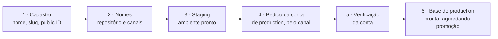

Uma organização entra pelo Backstage, recebe um ambiente de staging e um de production, e nela nascem os projetos. **O Backstage é a fonte da verdade**: o que se define nele reflete igual no GitHub, no Slack, na AWS e na instalação, e nunca é redigitado.

## Uma organização nova

A organização nasce no Backstage, e cada passo do caminho é um fluxo do Workflow Manager, visível na mesma tela. O fluxo segue sozinho e só para para uma pessoa quando um passo pede uma decisão que o Backstage não pode tomar. A parada aparece como `waiting`, com o motivo.

| Passo | O que acontece |
|---|---|
| 1 · Cadastro | Quem cria a organização, o client partner, o builder ou o enabler, escolhe o slug. O núcleo sorteia o public ID, um só para a organização, o mesmo em staging e em production. |
| 2 · Nomes | O slug dá nome ao repositório `barte-ai-platform-<slug>`, aos dois canais do Slack e ao alias da instalação, sempre igual, sem variante. As regras estão em [nomes](/how-we-work/naming). |
| 3 · Staging | O ambiente de staging se prepara uma vez: a conta, a rede, a base, o core operacional (Identity Manager, Workflow Manager e Data Operator) e os conectores. |
| 4 · Pedido da conta | Com staging no ar, o fluxo pede a conta de production à Cyber Security, no canal de pedidos de conta, num formato fixo. A resposta chega na thread e continua o fluxo. |
| 5 · Verificação | O fluxo confere a conta antes de usá-la: que ela existe, está ativa, está na OU certa e segue o nome da convenção. Um campo errado volta como pergunta na thread. |
| 6 · Base de production | Com a conta verificada, o fluxo prepara a base de production sem esperar ninguém. Production aparece como «pronta, aguardando promoção». |

A conta de production é sempre da organização, dentro da org AWS da Barte. Nenhuma instalação roda numa conta da própria organização. Staging roda na conta compartilhada de staging da Barte.

A espera pela conta tem prazo de um dia. Sem resposta, o fluxo cobra na thread em intervalos cada vez menores, só em horário comercial, e em 72 horas dispara um alarme e menciona o tech lead.

### O que liga em cada instalação

O Backstage guarda, por instalação, quais componentes e conectores estão ligados, e a instalação lê essa escolha em tempo de execução.

- **O Identity Manager e o Shell estão sempre ligados.** São o login e a moldura.
- **Um conector só liga com o Integration Gateway ligado.**
- **Production liga pela promoção.** Fora dela, em production, só se liga o que já está ligado e entregue em staging, com um motivo; desligar é sempre permitido, com motivo.
- **Cada mudança grava quem, o quê, de que valor para que valor e quando.**

## Um projeto novo

Um projeto é uma **linha de operação**: uma frente de trabalho de ponta a ponta, que delimita a infraestrutura de que precisa para operar. Contas a pagar é um projeto, e contas a receber é outro. Os dois dividem a instalação da organização.

| Regra | O que diz |
|---|---|
| O identificador | O núcleo sorteia o identificador do projeto quando ele nasce. É único na organização, nunca muda e é a chave do projeto em tudo. |
| O slug | Segue a regra do slug da organização e é único dentro dela. Nunca é chave. |
| O repositório é da organização | Os projetos moram em `projects/<project-slug>/` do repositório da organização. Nenhum projeto tem repositório próprio. |
| O que é do projeto | Os fluxos, as views (transformações e projeções), os dashboards, os apps e os agents. O ambiente não é do projeto: a conta, a base, o core e os conectores são da organização. |
| Um incremento não é projeto | Um provedor novo, um fluxo a mais ou uma view nova continuam no mesmo projeto, na mesma Initiative ou numa milestone dela. Um projeto novo só nasce com uma linha de operação nova. |
| Versões e cortes por projeto | Cada projeto tem as suas versões, os seus cortes e a sua promoção, no mesmo repositório. Voltar uma versão de um projeto não mexe nos outros ([do commit à produção](/how-we-work/delivery)). |

Um projeto novo não pede conta, base nem instalação nova: ele nasce no repositório e se aplica sobre o ambiente que já está pronto. Uma versão que precisa de um conector que o ambiente ainda não tem volta para o ambiente: o conector liga primeiro, e a versão se aplica depois.

### O dado da organização entra pelo Data Operator

Todo dado passa pelo Data Operator. Cada modelo de dados que entra de uma organização gera **o canônico**: o modelo canônico na camada silver, com os vínculos entre as entidades e o grafo dos dados. As views e os dashboards do projeto leem do canônico, e não do formato de cada provedor. O detalhe está em [dados](/specifications/data).

### O trabalho do projeto

Todo trabalho do projeto segue o [caminho de uma mudança](/how-we-work): um plano aprovado numa [issue de plano](/how-we-work/issues#a-issue-de-plano), a agência, o pull request e a review. O time de uma organização são os fdes, os engenheiros que constroem com ela, o client partner e o AI Enabler, o tech lead do projeto, que corta as versões.

## Do projeto para a plataforma

Uma decisão tomada no projeto de uma organização é avaliada para escalar para as outras, desde que não seja regra de negócio própria daquela organização. O processo de análise, de candidata e de promoção é o canônico, e está em [promoção para a plataforma](/how-we-work/promotion).

Fonte: ADR-002 D1, ADR-004 D5 e D6, ADR-005 D1 a D5, ADR-009 D2 e D4 e ADR-010 D1 a D3 do backstage, regra de 02/11/2026 (o canônico).
