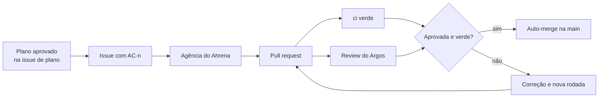

Este handbook vale para todo repositório da organização `barte-ai-services` e para toda pessoa ou IA que trabalha neles. Ele mora no repositório [`barte-ai-services/.github`](https://github.com/barte-ai-services/.github), e é de lá que ele desce para os projetos.

## O caminho de uma mudança

1. **Nada se constrói sem um plano aprovado.** O plano vive numa [issue de plano](/how-we-work/issues#a-issue-de-plano), sub-issue da issue que ele resolve, e uma pessoa o aprova antes da primeira linha de código.
2. **A issue carrega os critérios de aceite** numerados, `AC-1`, `AC-2`, e cada um tem um teste que o nomeia.
3. **A [agência do Ahrena](/how-we-work/agency)** constrói camada por camada, a partir do plano aprovado.
4. **O [pull request](/how-we-work/pull-requests)** fecha a issue. O `ci` é o único check obrigatório.
5. **A [review do Argos](/how-we-work/review)** fica no lugar da revisão humana obrigatória. Com a review aprovada e o `ci` verde, o PR entra sozinho, por auto-merge.
6. **A [documentação](/how-we-work/documentation)** vai no mesmo PR, escrita por um subagent ao lado de quem coordena.

Do merge em diante, o caminho até staging e production está em [do commit à produção](/how-we-work/delivery).

## As regras por cima de tudo

- **[Segurança antes de meta](/how-we-work/security).** Menor exposição e menor raio de dano valem sobre prazo e conveniência.
- **Dados passam pelo Data Operator; processos duráveis e de alta carga, e todo workflow, pelo Workflow Manager.** O Airflow só serve para o paralelismo dentro de um pipeline de dados. O detalhe está em [dados](/specifications/data) e [workflows](/specifications/workflows).
- **O Identity Manager é o único login**, e o Workflow Manager é o único orquestrador.
- **«Organização», nunca «cliente»**, para a empresa que a Barte atende. O papel de client partner continua com esse nome.
- **O Backstage é a fonte dos nomes.** O que se define nele, como o slug, reflete igual em todos os outros sistemas ([nomes](/how-we-work/naming)).
- **[Bastidores em inglês, pt-BR na tela](/how-we-work/language).**

## Quem segue

Toda IA que trabalha num repositório da Barte segue este handbook. Cada repositório carrega no `AGENTS.md` um bloco que aponta para cá: [como as IAs seguem o handbook](/how-we-work/agents). O estado de cada repositório está em [adotar o handbook](/how-we-work/adoption).

## Quando o projeto discorda

O handbook é o padrão. Um projeto só se afasta dele por um ADR próprio, em `docs/architecture/decisions/`, que diz o que muda e por quê. Uma mudança no handbook é um pull request para o `barte-ai-services/.github`, como qualquer outra mudança.

Fonte: regra de 02/11/2026 e decisões 1 e 2 da barte-ai-services/.github#24, ADR-004 D2 e ADR-009 D4 do backstage, ADR-001 R1 do backstage.
