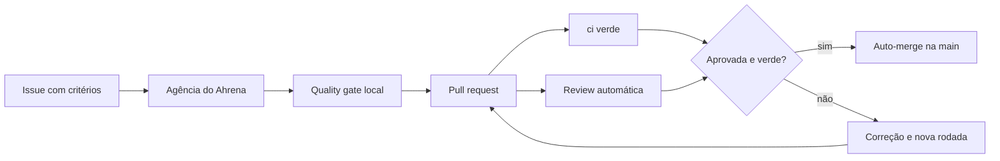

Este handbook vale para todo repositório da organização `barte-ai-services` e para toda pessoa ou IA que trabalha neles. Ele mora no repositório [`barte-ai-services/.github`](https://github.com/barte-ai-services/.github), e é de lá que ele desce para os projetos.

## O caminho de uma mudança

1. **Toda mudança nasce numa [issue](/how-we-work/issues)**, aberta pelos issue forms da organização, com critérios de aceite numerados.
2. **A [agência do Ahrena](/how-we-work/agency)** planeja, constrói e revisa camada por camada. É o caminho padrão de construção.
3. **O [pull request](/how-we-work/pull-requests)** fecha a issue, e o `ci` é o único check obrigatório.
4. **A [review automática](/how-we-work/review)** fica no lugar da revisão humana obrigatória. Com a review aprovada e o `ci` verde, o PR entra sozinho.
5. **A [documentação](/how-we-work/documentation)** vai no mesmo PR, escrita por um subagent que trabalha ao lado de quem coordena.

Por cima de tudo isso valem duas regras: [segurança antes de meta](/how-we-work/security) e [bastidores em inglês, pt-BR na tela](/how-we-work/language).

## Quem segue

Toda IA que trabalha num repositório da Barte segue este handbook. Cada repositório carrega no `AGENTS.md` um bloco que aponta para cá: [como as IAs seguem o handbook](/how-we-work/agents). O que cada projeto faz para aderir está em [adotar o handbook](/how-we-work/adoption).

## Quando o projeto discorda

O handbook é o padrão. Um projeto só se afasta dele por um ADR próprio, em `docs/adr/`, que diz o que muda e por quê. Uma mudança no handbook é um pull request para o `barte-ai-services/.github`, como qualquer outra mudança.
