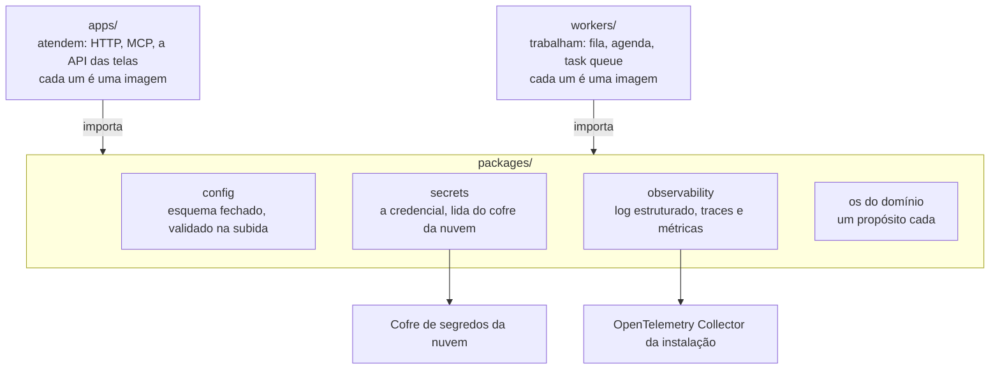

Cada cliente tem um repositório com todos os seus projetos. Cada módulo da plataforma tem o seu. Todos seguem o mesmo esqueleto. O caminho de uma mudança até a produção está em [do commit à produção](/how-we-work/delivery).

## O esqueleto comum

Repositórios de cliente e de módulo têm a mesma estrutura de pastas. Só o código muda.

```text
<repositório-do-cliente>/
├─ .forge/          a configuração do Barte Forge
├─ .claude/         Claude Code: settings, skills e comandos
├─ .codex/          Codex: configuração local
├─ AGENTS.md        as regras do repositório, para agentes
├─ CLAUDE.md        importa o AGENTS.md
├─ README.md        o que é, estado, como sobe, layout, fronteiras
├─ LICENSE          proprietária e confidencial
├─ NOTICE           software de terceiros e licenças
├─ versions.tf      a versão fixada de cada módulo
├─ infra/
│  └─ terraform/{aws | gcp | azure | ...}/
│                   a instalação, o que roda na nuvem do cliente:
│                   conta, rede e um deployment de cada módulo
├─ connectors/      os conectores do Integration Gateway da instalação
├─ brand/           a marca que as telas usam
├─ packages/        config · secrets · observability, e o compartilhado
├─ projects/
│  └─ <projeto>/    um projeto do cliente; podem ser vários
│     ├─ apps/      os serviços que atendem, um por pasta
│     ├─ workers/   os processos que trabalham, um por pasta
│     ├─ packages/  as bibliotecas do projeto, uma por pasta
│     ├─ agents/    agentes, bots e workers, do Agent Hub e do projeto
│     ├─ flows/     os fluxos do Workflow Manager deste projeto
│     ├─ tests/     contract · integration · e2e · pentest
│     ├─ docs/      a documentação do projeto
│     └─ deploy/
│        ├─ compose/    sobe local, com os módulos em contêiner
│        └─ terraform/{aws | gcp | azure | ...}/
│                       só os apps e workers do projeto
├─ Makefile         help · up · down · logs · clean · check
├─ .env.example     toda variável que a subida lê, sem valor real
└─ .github/
   ├─ CODEOWNERS    o dono de cada pasta
   └─ workflows/    ci · publish · staging · release · deploy · docs
```

O repositório de um módulo não tem `versions.tf`, `infra/`, `connectors/`, `brand/` nem `projects/`. As pastas de código, `tests/`, `docs/` e `deploy/` ficam na raiz.

### O que é obrigatório

| Item | Quando | Por quê |
|---|---|---|
| `.forge/`, `.claude/`, `.codex/` | Sempre | O agente abre o repositório com as regras carregadas. Ver [os agentes de desenvolvimento](#os-agentes-de-desenvolvimento). |
| `LICENSE` e `NOTICE` | Sempre | Código proprietário e software de terceiros. Ver [a licença](#a-licença). |
| `apps/`, `workers/`, `packages/` | Quando há código | Serviços, processos em segundo plano e bibliotecas. Ver [o código](#o-código). |
| `README.md` | Sempre | O primeiro arquivo lido, em ordem fixa. |
| A documentação | Sempre | A decisão escrita fica para quem chega depois. Ver [a documentação](#a-documentação). |
| `deploy/compose/` | Quando há deployável | Sobe tudo local, sem conta de nuvem. |
| `deploy/terraform/<alvo>/` | Quando há deployável, um por alvo | No módulo, é o que o `infra/` do cliente consome. |
| `versions.tf` e `infra/` | No repositório do cliente | Fixam a versão de cada módulo da instalação. |
| `Makefile` | Quando há deployável | Os mesmos alvos em todo repositório. |
| `.env.example` | Quando a subida lê o ambiente | As variáveis a declarar antes de subir. |
| `.github/CODEOWNERS` | Sempre | O dono de cada pasta. |
| `.github/workflows/` | Sempre, com os nomes de [do commit à produção](/how-we-work/delivery#os-workflows) | Sem código, o `ci.yml` valida o formato. |

A AWS é a referência: todo módulo escreve o alvo dela primeiro, e os outros alvos são comparados a ele.

## O código

`apps/` atendem requisições, `workers/` executam trabalho em segundo plano, e `packages/` guarda as bibliotecas que os dois usam.

```text
apps/
└─ <nome>/        um serviço que atende: HTTP, MCP, a API das telas
   ├─ src/
   ├─ test/
   ├─ Dockerfile
   └─ package.json | pyproject.toml
workers/
└─ <nome>/        um processo que trabalha: fila, agenda, task queue
   ├─ src/
   ├─ test/
   ├─ Dockerfile
   └─ package.json | pyproject.toml
packages/
└─ <nome>/        uma biblioteca, com um propósito só
   ├─ src/
   ├─ test/
   └─ package.json | pyproject.toml
```

O nome de cada item diz o que ele faz: `apps/proxy`, nunca `apps/app`.



`apps/` e `workers/` importam `packages/`, e um não importa o outro.

| Regra | O que diz |
|---|---|
| A dependência desce | Pacote nunca importa deployável (app ou worker). Deployável nunca importa outro: o comum vira pacote. |
| O build garante | Cada pasta é membro do workspace. Um import proibido falha no build. |
| Três pacotes em todo repositório | Todo app e worker usa os três. `config` valida a configuração na subida. `secrets` lê as credenciais do cofre da nuvem. `observability` exporta log, traces e métricas por OTLP. |
| Um pacote, um propósito | `edge`, `ratelimit`, `pack`. Nunca `utils` nem `common`. |
| O teste fica junto | Cada pasta tem o seu `test/`. O teste de pacote roda sem subir serviço. |
| Cada app é um artefato | Cada pasta de `apps/` e `workers/` vira uma imagem no GHCR, o registro de imagens do GitHub. |
| Versão privada | A versão é a do módulo, pela tag. Um pacote não é publicado à parte. |

| Linguagem | Workspace | Membros |
|---|---|---|
| TypeScript | pnpm, em `pnpm-workspace.yaml` | `apps/*`, `workers/*` e `packages/*` |
| Python | uv, em `[tool.uv.workspace]` no `pyproject.toml` da raiz | `apps/*`, `workers/*` e `packages/*` |

## A documentação

O site e as decisões seguem a página de [documentação](/how-we-work/documentation): o site em `docs-site/`, os ADRs em `docs/adr/`. O que a documentação de um repositório responde, por assunto:

| Assunto | Responde |
|---|---|
| Arquitetura | Como o repositório é construído, e por quê. O que está em aberto. |
| Domínio | Os objetos de negócio, os vínculos e os termos. |
| Workflows | Os processos, do gatilho ao resultado. |
| Referência | A interface exposta: rotas, schema, ferramentas e eventos. São os contratos. |
| Operação | Como operar em produção: alertas, falhas e procedimentos manuais (runbooks). |
| Segurança | Os dados, quem os acessa, a guarda da credencial e o que nunca sai. |
| Agentes | O que um agente de IA lê: ferramentas MCP, skills e o que ele recusa. O código do agente fica no Agent Hub. |
| Contexto | Só em projeto de cliente: o processo do cliente, o objetivo, os critérios de aceite e as entregas. |

### As decisões

Uma decisão cara de desfazer vira um ADR. O nome do arquivo é o número e a decisão em frase, como `0002-the-graph-is-a-linkable-projection.md`.

```md
# <A decisão, em frase>

**Status:** Proposta | Aceita | Substituída por NNNN
**Data:** AAAA-MM-DD
**Decisor:** <nome>

## Context
## Decision
## Consequences
## Alternatives considered
```

| Regra | O que diz |
|---|---|
| Numeração | O número não muda: issues e outros repositórios citam a decisão por ele. |
| Mudança | Um ADR novo altera ou substitui o antigo, e os dois registram isso. |
| Mudança de casa | Uma decisão sobre outro módulo vai para o repositório dele, com número novo e a origem registrada. |
| Onde mora | A decisão de um módulo fica no módulo. A plataforma cita o ADR sem copiar. |

## Os agentes de desenvolvimento

Todo repositório vem configurado para agentes de desenvolvimento, como Claude Code e Codex.

| Pasta | Guarda |
|---|---|
| `.forge/` | O Barte Forge, o harness de desenvolvimento do time: a versão usada, as regras, as skills e os comandos locais. |
| `.claude/` | O Claude Code: `settings.json` (permissões e hooks), skills, agentes e comandos. |
| `.codex/` | A configuração do Codex. |

Cada regra é escrita uma vez. A regra do time vem do Forge. A regra do repositório fica em `.forge/` e no `AGENTS.md`, ao lado do [bloco do handbook](/how-we-work/agents). `.claude/` e `.codex/` só adaptam as regras a cada ferramenta.

- A configuração pessoal, como `.claude/settings.local.json`, entra no `.gitignore`.
- Nenhuma das três pastas guarda credencial.

## A licença

Todo repositório tem `LICENSE` e `NOTICE` na raiz.

| Arquivo | Diz |
|---|---|
| `LICENSE` | Código e documentação são proprietários e confidenciais. Copiar, distribuir ou publicar exige autorização por escrito. A entrega a cliente segue o contrato. Só o ano muda entre repositórios. |
| `NOTICE` | O software de terceiros, por pasta, com a licença de cada um. Ele é instalado no build, sem cópia no repositório. Lista também o dono de cada logo e nome citado. |

- **Uma dependência nova atualiza o `NOTICE`**, no mesmo commit.
- **Uma licença com condição de uso**, como AGPL ou comercial, entra com o limite de uso escrito.

## O README

O README segue esta ordem. Os títulos podem variar.

| Seção | Responde |
|---|---|
| Abertura | O que o módulo é, onde termina, se é reutilizável e a stack. |
| Estado | O que existe e o que falta. Uma task que falha de propósito aparece aqui. |
| Subir | O comando que sobe local, e o que sobe junto. |
| Layout | A árvore do repositório, uma linha por diretório. |
| Entrega | Como sai uma versão, e onde o artefato é publicado. |
| Fronteiras | De quem depende e quem depende dele, com link para cada repositório. |
| Licença | Uma linha, com link para o `LICENSE` e o `NOTICE`. |

O README aponta para a documentação sem repetir o conteúdo. As decisões entram como uma tabela de ADRs.

## Revisão e issues

- **`CODEOWNERS`** diz quem é dono de cada pasta. A regra geral (`*`) vem primeiro, porque vale a última que casa. `/.github/`, `deploy/` e `infra/` têm dono explícito. Como um PR entra está em [pull requests](/how-we-work/pull-requests).
- **Os modelos de issue** são os da organização, e todo trabalho entra por issue, com tipo: [issues](/how-we-work/issues).

## Nomes e idioma

A regra de idioma está em [bastidores em inglês, pt-BR na tela](/how-we-work/language). No repositório, ainda valem:

| Assunto | Regra |
|---|---|
| Repositório | O de um módulo tem nome em minúscula e sem prefixo da empresa. O de um cliente segue o padrão do template da plataforma com o nome do cliente no fim. |
| Tempo | Um instante que atravessa fronteira é UTC em RFC 3339, com `Z`. |
| Organização | Todo repositório da plataforma fica em `barte-ai-services`. |

## Os módulos

A plataforma tem quatro módulos. O Integration Gateway é o modelo: os outros acrescentam ao esqueleto o que precisam.

| Módulo | O que guarda |
|---|---|
| **Integration Gateway** | Os conectores. É a única porta para fora da conta: HTTP e MCP. |
| **Data Operator** | O dado, o histórico, as projeções e a ontologia. |
| **Workflow Manager** | Os processos duráveis, com espera e aprovação. |
| **Identity Manager** | O login, as organizações, os papéis e o alcance de cada um. |

### O Agent Hub, o acervo reutilizável

O Agent Hub guarda agentes, bots e workers comuns a vários projetos. Ele não sobe como serviço: o projeto usa o item por versão fixada, sem copiar o código.

```text
├─ agents/<nome>/    recebe, aciona ferramenta, devolve
├─ bots/<nome>/      conversa num canal: chat, mensagem, e-mail
├─ workers/<nome>/   um processo comum a vários projetos
├─ skills/<nome>/    a instrução versionada de um caso
├─ packages/         config · secrets · observability
├─ docs/
└─ deploy/compose/
```

| Regra | O que diz |
|---|---|
| Cada item é um artefato | Uma imagem no GHCR, na versão da tag do Agent Hub. |
| O projeto implanta | O `deploy/` do projeto implanta o item na instalação do cliente, na versão fixada. |
| Entra quando serve a dois | O item nasce no projeto e sobe para o Agent Hub quando um segundo cliente precisa. Entre projetos do mesmo cliente, sobe só até o `packages/` da raiz. Ver [do cliente à plataforma](/how-we-work/development-cycle#a-escada-da-promoção). |
| Sem nada de cliente | Nada cita cliente, dado de cliente ou credencial. O que varia entra por configuração. |

| Pasta | Tecnologia | Por quê |
|---|---|---|
| `agents/` | LangGraph, sem o checkpointer | Roda o loop do agente. O estado durável fica no motor do Workflow Manager, o único motor de durabilidade. |
| `skills/` | Markdown e `skill.yml`, sem framework | Instrução em texto serve a agentes de qualquer framework. |
| `bots/` | A biblioteca de cada canal | Cada bot usa a biblioteca do seu canal. |
| `workers/` | Temporal | O motor do Workflow Manager. O worker se conecta ao da instalação. |
| O modelo | LiteLLM | O único acesso ao modelo de IA. Cada item escolhe o modelo, com limite por chave. |
| `packages/` | Python e TypeScript | Os pacotes existem nas duas linguagens. |

Um contrato, uma implementação por linguagem:

| Pacote | Fonte única | Como as duas linguagens seguem |
|---|---|---|
| `config` | JSON Schema | Zod e Pydantic gerados do mesmo schema. |
| `secrets` | A interface e os provedores: env, file e os cofres de cada nuvem | As mesmas fixtures de conformidade, nas duas. |
| `observability` | O catálogo de eventos e os atributos do OpenTelemetry, como dado | A suíte confere o mesmo evento, com os mesmos campos. Cada uma usa o SDK do OpenTelemetry da linguagem. |

O Barte Forge fica fora dos módulos e do Agent Hub, e não tem `apps/`, `workers/` nem `packages/`.

## O repositório do cliente

Cada cliente tem um único repositório, e todos os projetos dele ficam ali, cada um numa pasta de `projects/`. A árvore é a do esqueleto.

| Regra | O que diz |
|---|---|
| Um deployment de cada módulo | O `infra/` da raiz sobe a conta, a rede e os quatro módulos, nas versões do `versions.tf`. Todos os projetos usam essa instalação, o conjunto que roda na nuvem do cliente. |
| O projeto sobe só o que é dele | O `deploy/` do projeto implanta os apps e workers dele. Os workers usam o motor do Workflow Manager. Os provedores viram fluxos agendados no Data Operator. O login passa pelo Identity Manager. |
| Um Integration Gateway para todos | Os conectores de todos os projetos ficam em `connectors/`. O Integration Gateway é a única saída da conta. |
| O projeto é autocontido | Um projeto não importa outro, só o `packages/` da raiz. O que servir a outro cliente sobe para um módulo. |
| O artefato é do cliente | Cada imagem leva o nome do cliente, e o nome é único entre os projetos. |
| O acervo não nasce aqui | Um conector novo nasce no Integration Gateway. Um agente, bot ou worker que serve a mais de um projeto sobe para o Agent Hub. |

Staging, production e o caminho até a conta do cliente estão em [do commit à produção](/how-we-work/delivery).
