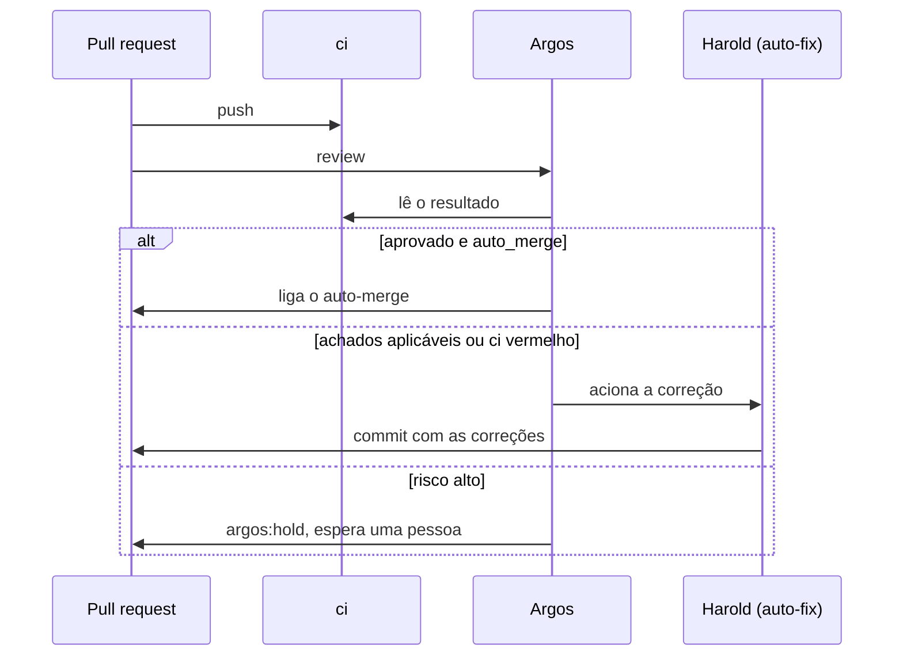

A revisão humana obrigatória sai, e a review automática entra no lugar dela. Ela é a primeira coisa que olha um PR na Barte, roda em paralelo ao `ci` e não soma tempo a ele.

## O Argos

O **Argos**, o revisor do Ahrena, lê o PR contra as regras do framework e publica o parecer no próprio PR. Ele só lê: não sobe a aplicação, não builda e não roda teste.

1. **Ele lê o resultado do CI antes do parecer.** Uma checagem vermelha vira um achado bloqueante.
2. **Um decisor avalia o risco.** Depois da review, um modelo de decisão estima o risco, a chance de regressão e a chance de o PR poder entrar sem uma pessoa, e aplica os limiares. A decisão é `auto_merge` ou `hold_for_human`, e vai no parecer com as probabilidades.
3. **Quando o Argos aprova e a decisão é `auto_merge`**, ele liga o auto-merge do PR, que entra quando o `ci` passar.
4. **Quando ele segura o PR**, aplica o label `argos:hold`, e o auto-merge fica desligado até uma review aprovar.

O Argos tem dois modos. Em `comment`, o parecer é um comentário e o check fica verde: é o modo de calibrar. Em `block`, um achado bloqueante deixa o check vermelho.

## O ciclo de correção

A esteira de review da Barte, o **Harold**, chama o Argos e fecha o ciclo: quando a review aponta achados aplicáveis, ou quando o `ci` fecha vermelho, ela aplica as correções no próprio PR, faz o commit e deixa o commit novo disparar outra rodada. Depois de um número limitado de tentativas, o PR escala para uma pessoa.

## Como ligar num repositório

O workflow vem do modelo da organização `argos`, que chama o workflow reutilizável `barte-ai-services/.github/.github/workflows/argos.yml@main`. No GitHub, **Actions › New workflow** mostra o modelo.
