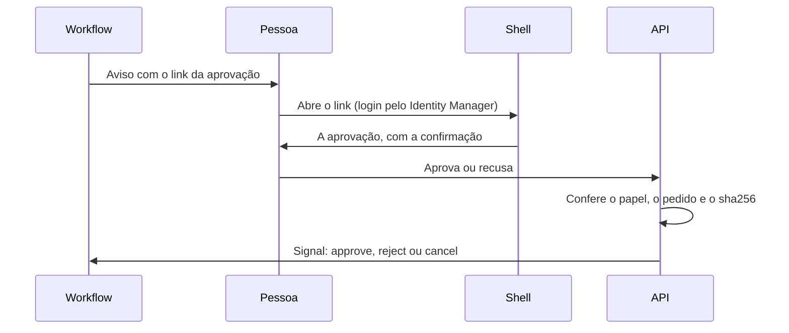

## O princípio

**Nada irreversível acontece sem uma pessoa aprovar.** Um envio a terceiro, uma confirmação a um parceiro, a devolução de um documento: cada um espera a aprovação de quem decide.

**A aprovação é sempre por link, e nunca por e-mail.** A pessoa abre o link, chega ao portal já na aprovação e decide lá. É assim que o primeiro projeto de faturamento já funciona.

## O caminho

1. **O aviso leva um link** que abre o portal (o Shell) já na aprovação: o item, com `?confirm=approve` ou `?confirm=reject`, e o sha256 da versão exata que está sendo aprovada. Um terceiro botão só abre o portal.
2. **A pessoa decide no portal, com login pelo Identity Manager.** Uma janela de confirmação vem antes da ação irreversível.
3. **A decisão chega ao workflow que espera como um signal do Temporal**: `approve`, `reject` ou `cancel`. Antes de sinalizar, a API confere o pedido e o sha256 contra o estado do workflow.

## Quem decide

- **Decidir exige o papel que decide**: `approver` ou `owner`. O `operator` opera, mas nunca decide.
- **A API confere o papel, e não o menu.** Esconder o botão não é controle de acesso.

## O que nunca vale

- **Ninguém aprova respondendo a um e-mail.**
- **Nenhum link decide sozinho, sem login.** O link leva à aprovação; quem decide é a pessoa, autenticada.

## A aprovação é da versão

- **A aprovação fica presa ao sha256 da versão.** Editar cria uma versão nova, com sha256 novo.
- **Um link antigo, que aponta para outra versão, é recusado** («rascunho trocado»).
- **Uma recusa retira a aprovação pendente dos mesmos bytes.**
- **Um e-mail aprovado não se cancela mais**: o pedido de cancelar é `409` com o code `conflict` ([catálogo](/specifications/errors/catalog)).

## A auditoria

Cada decisão grava, no portão do workflow: a ação, o workflow, quem, quando, o pedido e o sha256, mais a nota ou o motivo.

Fonte: decisão do Fernando de 02/11/2026 (barte-ai-services/.github#24), a prática do projeto de faturamento (ADR-0029 do projeto).
