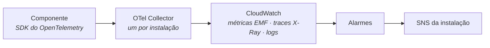

## O caminho

- **Todo componente instrumenta com o SDK do OpenTelemetry**, por `packages/observability`. Nenhum código fala com um fornecedor de observabilidade direto.
- **Cada instalação tem o seu Collector**, que entrega ao CloudWatch da conta da instalação.

## Logs

- **Um log é JSON numa linha**, no modelo de dados de log do OpenTelemetry, com `trace_id` e `span_id`.
- **Todo log de um pedido leva o `request_id`**, o `X-Request-Id` que nasceu na borda, um UUIDv4 ([cabeçalhos](/specifications/apis/headers)).
- **A mensagem é fixa**, e o que varia vai em campos. Os eventos de cada componente estão num catálogo ([eventos](/specifications/events)).
- **Log nunca leva segredo nem dado pessoal.** O endereço com credencial sai redigido.

## Alarmes

- **Todo alarme vai ao tópico SNS de alarmes da instalação**, `barteai-<public_id>-base-alrm`, e dele às pessoas por e-mail e, quando a instalação o liga, ao Slack.
- **O canal de Slack de alarmes é um canal interno do time.** Nada automático é postado no canal externo da organização, `#externo-fde-<slug>-barte`.
- **Toda falha que um fluxo não resolve sozinho vira alarme**, e cada alarme tem um runbook.

## Runbook

**Cada componente tem o seu runbook em `docs/operations/README.md`**: o que cada alarme quer dizer, onde olhar e o que fazer.

## Os pacotes de todo componente

| Pacote | O que é |
|---|---|
| `packages/observability` | Log, trace, métrica e o catálogo de eventos |
| `packages/config` | A leitura da configuração ([configuração](/specifications/configuration)) |
| `packages/secrets` | A leitura das credenciais |

Enquanto um pacote não tem código, o README dele diz o que faz o papel dele. Não há um segundo lugar.

Fonte: `barte-ai-platform/infra/aws/terraform` (Collector e tópico de alarmes), `loom/AGENTS.md`, `gatekeeper/packages/observability`, ADR-004 D5 do Backstage, ADR-009 do Backstage (canais), decisão do Fernando de 02/11/2026 (barte-ai-services/.github#24).
